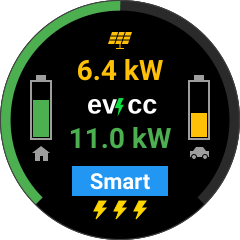

# Wallbox knob display

A small round wallbox display and controller for Home Assistant, built with ESPHome on the
VIEWE UEDX24240013-MD50E knob display (ESP32-C3, 1.28" round GC9A01 240×240, rotary encoder with push button).
It is meant to sit next to the wallbox: you see PV power, charge power and battery levels at a glance,
and you switch the charge mode by turning and pressing the knob.

It works with any charge controller that provides its values and a mode select as Home Assistant
entities. The defaults are set up for [evcc](https://evcc.io); other controllers (for example openWB,
go-e or a wallbox integration) work by mapping your own entities and mode options.

## Features

- **Charge ring** along the edge: wallbox charge power, full scale configurable (default 22 kW).
  While charging, the ring fills up animated.
- **PV power** with a solar panel icon.
- **Charge power** with the evcc logo (default) or a charging station icon.
- **Home battery** (left) and **vehicle battery** (right) as battery bars, coloured red/yellow/green by SoC.
  Animated while charging, reversed while the home battery discharges.
- **Charge mode** (off / smart / now): turn the knob to preselect, press to send it to the charge controller.
  An unconfirmed selection expires after 8 s.
- **Active phases** as three bolts below the mode.
- **Display timeout** adjustable in Home Assistant (`Display Timeout`, seconds, 0 = never).
  Turning or pressing the knob wakes the display without changing the mode.

## Requirements

- VIEWE UEDX24240013-MD50E (ESP32-C3 knob display)
- Home Assistant with the ESPHome add-on (or ESPHome CLI), ESPHome 2025.x or newer
- Charge controller entities in Home Assistant (with evcc for example via the evcc integration)

## Installation

1. Create a new device in the ESPHome dashboard and replace its YAML with [`example.yaml`](example.yaml).
2. Change the `url` under `packages:` to this repository, if you use a fork.
3. Add the entries from [`secrets.example.yaml`](secrets.example.yaml) to your ESPHome `secrets.yaml`.
4. Map your entities in the `substitutions:` block (see below).
5. Flash it once via USB, after that updates go over the air.
6. In Home Assistant open **Settings → Devices & services → ESPHome → your device → Configure** and enable
   **Allow the device to perform Home Assistant actions**. Without it, pressing the knob cannot change the mode.

## Configuration

All settings are substitutions. Override only the ones you need in your device config.

### Entities

| Substitution | Default | Meaning |
|---|---|---|
| `entity_pv_power` | `sensor.evcc_pv_power` | PV power |
| `entity_charge_power` | `sensor.evcc_garage_charge_power` | Loadpoint charge power |
| `entity_charging` | `binary_sensor.evcc_garage_charging` | Loadpoint is charging |
| `entity_mode` | `select.evcc_garage_mode` | Loadpoint mode select |
| `entity_phases_active` | `sensor.evcc_garage_phases_active` | Active phases (1–3) |
| `entity_car_soc` | `sensor.evcc_garage_vehicle_soc` | Vehicle SoC in % |
| `entity_home_batt_soc` | `sensor.evcc_battery_soc` | Home battery SoC in % |
| `entity_home_batt_power` | `sensor.evcc_battery_power` | Home battery power |

The defaults fit evcc, where `garage` is the title of the loadpoint, so your entity IDs will most likely differ.
For other charge controllers map their entities and set the three `mode_*_option` values to the options of their mode select.
Without a home battery, simply leave the defaults: the left battery then stays empty.

### Units, signs and mode values

| Substitution | Default | Meaning |
|---|---|---|
| `pv_power_divisor` | `1000.0` | PV value ÷ divisor = kW (`1000.0` for W, `1.0` for kW) |
| `charge_power_divisor` | `1.0` | Charge power ÷ divisor = kW |
| `home_batt_power_factor` | `1.0` | Battery power × factor must be negative while charging; set `-1.0` to flip |
| `mode_off_option` / `mode_smart_option` / `mode_now_option` | `off` / `smart` / `now` | Option values of your mode select |

### Look and behaviour

| Substitution | Default | Meaning |
|---|---|---|
| `label_off` / `label_smart` / `label_now` | `Off` / `Smart` / `Fast` | Mode texts on the display |
| `label_confirm` | `Press = OK` | Hint while a mode is preselected |
| `charge_icon` | `evcc` | `evcc` = evcc logo, `wallbox` = charging station icon |
| `max_charge_kw` | `22.0` | Full scale of the charge ring |
| `batt_threshold_w` | `50.0` | Battery counts as (dis)charging above this power |
| `display_timeout_default` | `120` | Initial display timeout in seconds |
| `anim_steps` | `8` | Animation steps (× 400 ms) |
| `wake_guard_ms` | `600` | Knob steps right after waking up are ignored this long |

## Hardware notes

| Function | GPIO |
|---|---|
| SPI CLK / MOSI | 1 / 0 |
| Display CS / DC / RESET | 10 / 4 / 2 |
| Backlight (PWM, inverted) | 8 |
| Encoder A / B | 6 / 7 |
| Button | 9 |

The display uses the `mipi_spi` driver with a partial buffer, because the ESP32-C3 has no PSRAM and a
full frame buffer (115 KB) does not fit next to WiFi and the API.

## Credits

- Pinout from the Home Assistant community and [dmit2k/viewe-knob-display-esphome](https://github.com/dmit2k/viewe-knob-display-esphome).
- evcc and the evcc logo belong to the [evcc project](https://evcc.io). This project is not affiliated with evcc. With `charge_icon: "wallbox"` the logo is not used.

## License

[GPL-3.0](LICENSE)
