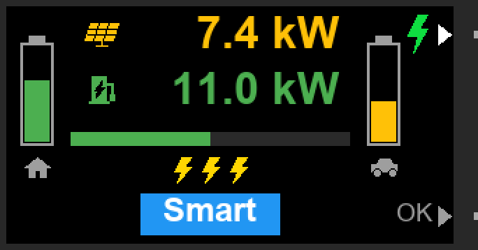

# Wallbox knob display – standalone firmware

The same display functions as the ESPHome package, but **without ESPHome and Home Assistant**.
The firmware talks directly to the [evcc](https://evcc.io) REST API and brings its own settings page.

It runs on two boards:

| Board | Display | Operation | PlatformIO env | Image |
|---|---|---|---|---|
| VIEWE UEDX24240013-MD50E | 1.28" round, 240×240 | rotary knob with push button | `wallbox-knob` | `bin/wallbox-knob-<version>-*.bin` |
| LilyGO T-Display-S3 | 1.9" rectangular, 320×170 (landscape) | two buttons: select and confirm | `tdisplay-s3` | `bin/tdisplay-s3-<version>-*.bin` |

<p align="center">
  
</p>

> Status: early version (0.2.1), tested on both boards with evcc 0.319.

## Features

- Charge power as a ring (round display) or bar (T-Display), PV and charge power, home and vehicle
  battery, charge mode, active phases, animations while charging
- Select a charge mode (Off, Smart, Fast) and confirm it to send it to evcc; choose which modes are
  offered and how they are labelled
  - round display: turn the knob to preselect, press to confirm
  - T-Display: the upper button (KEY) selects the next mode, the lower button (BOOT) confirms;
    hints next to the buttons show which is which
- Display timeout; any input wakes the display without changing the mode
- Rotation for the mounting position, home battery can be hidden
- Local web page for all settings, status (incl. button state, last input and the evcc answer to the
  last mode change) and firmware update
- WiFi setup via its own access point with captive portal
- Over-the-air updates via the web page or PlatformIO (ArduinoOTA)
- evcc login with admin password or API key, if your evcc requires authentication

## Flash a ready-made image

The folder [`bin/`](bin/) contains the current firmware for both boards as ready-to-flash images:

| File | Use |
|---|---|
| `<board>-<version>-full.bin` | First install via USB, flash at offset **0x0** (bootloader, partitions and firmware) |
| `<board>-<version>-ota.bin` | Update via the settings page (Firmware update) |

Without installing anything: open the [ESP web flasher](https://espressif.github.io/esptool-js/) in Chrome or Edge,
connect the board via USB, click *Connect*, choose the `-full.bin` at address `0x0` and click *Program*.
With esptool:

```bash
esptool.py --chip esp32c3 write_flash 0x0 wallbox-knob-0.2.1-full.bin
```

```bash
esptool.py --chip esp32s3 write_flash 0x0 tdisplay-s3-0.2.1-full.bin
```

If the board is not detected, hold the knob button (round display) or the BOOT button (T-Display)
while plugging in USB (boot mode).

## Build and flash

Requires [PlatformIO](https://platformio.org) (CLI or the VS Code extension).

```bash
cd standalone
pio run -e wallbox-knob -t upload        # round display, first time via USB
pio run -e wallbox-knob-ota -t upload    # later over the air (wallbox-knob.local)
pio run -e tdisplay-s3 -t upload         # T-Display-S3, first time via USB
pio run -e tdisplay-s3-ota -t upload     # later over the air (wallbox-display.local)
```

Every build also writes both images of the board to `bin/` (script `scripts/merge_bin.py`). The version
comes from `FW_VERSION` in `platformio.ini`.

`tools/preview.py` renders both layouts as PNG without a device, with the same coordinates as the
firmware (`python tools/preview.py out.png --board tdisplay|knob`).

## First start

1. After flashing, the display shows **Setup** and the name of a WiFi network
   (`WallboxKnob-XXXX` or `WallboxDisplay-XXXX`).
2. Connect your phone to it. The settings page opens automatically, otherwise open `http://192.168.4.1`.
3. Enter your WiFi, the evcc address (for example `http://192.168.1.10:7070`) and the loadpoint number, then save.
4. The device restarts, joins your WiFi and is reachable at `http://wallbox-knob.local` (round display)
   or `http://wallbox-display.local` (T-Display).
5. Set an **admin password** on the settings page. Without it, anyone in your network can change the
   settings or upload firmware.

If the saved WiFi cannot be reached at startup, the device opens the setup network again and retries
the saved WiFi every 10 minutes.

## Settings

| Setting | Meaning |
|---|---|
| WiFi SSID, password, hostname | Network; the device is reachable at `http://<hostname>.local` |
| evcc address | URL of evcc incl. port, e.g. `http://evcc.local:7070` |
| Loadpoint number | evcc loadpoint, counted from 1 |
| evcc admin password / API key | Only needed if evcc requires a login to change the mode |
| Poll interval | How often the state is read from evcc (default 2000 ms) |
| Display timeout | Seconds until the display goes dark, 0 = never |
| Brightness | Backlight in % |
| Rotation | Round display: 0, 90, 180 or 270° clockwise. T-Display: 0° (USB-C and buttons on the right) or 180°. Applied immediately |
| Full scale | kW for a full charge ring or bar (default 22) |
| Charge icon (round) | evcc logo or charging station |
| Select button hint (T-Display) | evcc bolt or a text next to the select button |
| Show home battery | Untick if you have no home battery; the round display leaves its place empty, the T-Display moves the values to the left |
| Modes and texts | Which modes are offered, their labels on the display and their evcc names (default `off` / `smart` / `now`; for older evcc versions use `pv` instead of `smart`) |
| Confirm hint | Round display: text below the preselected mode. T-Display: text next to the confirm button |
| Select text, swap buttons (T-Display) | Text next to the select button; exchange the two buttons |
| Admin password | Protects the settings page (user `admin`) and OTA |

The display fonts contain ASCII only; ä ö ü ß in labels are shown as ae oe ue ss.

## evcc API

| Purpose | Request |
|---|---|
| Read state | `GET /api/state` (only the needed fields are parsed) |
| Set mode | `POST /api/loadpoints/<n>/mode/<off\|smart\|now>` |
| Login | `POST /api/auth/login` with `{"password": "…"}`, cookie `auth` |

Used fields: `pvPower`, `battery.soc` and `battery.power`, and per loadpoint `chargePower`, `charging`,
`connected`, `mode`, `phasesActive`, `vehicleSoc`. Tested with evcc 0.319. Older versions are handled
too: state wrapped in `result`, `batterySoc` / `batteryPower` at the top level, and the modes
`pv` / `minpv` (shown as Smart).

## Hardware notes

| | VIEWE UEDX24240013-MD50E | LilyGO T-Display-S3 |
|---|---|---|
| Chip | ESP32-C3 | ESP32-S3, 16 MB flash |
| Display | GC9A01 via SPI (CLK 1, MOSI 0, CS 10, DC 4, RST 2) | ST7789 via 8-bit parallel (D0–D7 39–42, 45–48; WR 8, RD 9, DC 7, CS 6, RST 5) |
| Backlight | GPIO 8, PWM, inverted | GPIO 38, PWM; display power GPIO 15 |
| Input | encoder A/B GPIO 6/7, button GPIO 9 | KEY GPIO 14 (select), BOOT GPIO 0 (confirm) |

A 3D-printable wall / cable duct enclosure for the round display is available on
[Printables](https://www.printables.com/model/1927125-wall-cable-duct-enclosure-for-viewe-esp32-c3-rotar).
If you build your own housing, leave room for the press travel: the push button sits
behind the display, and a housing that holds the display too tightly blocks it. The status page shows
whether presses arrive (Button: n presses).

## Code overview

| File | Content |
|---|---|
| `src/main.cpp` | Startup, WiFi, input handling, timeout, animation |
| `src/painter.h` | Drawing primitives, icons, colours and fonts shared by both layouts |
| `src/display_knob.cpp` | Round GC9A01 layout, rendered in bands (small RAM footprint on the C3) |
| `src/display_tdisplay.cpp` | T-Display-S3 landscape layout with button hints |
| `src/knob.cpp` / `src/buttons.cpp` | Rotary encoder and button / two debounced buttons |
| `src/evcc.cpp` | evcc API client in its own task |
| `src/web.cpp` | Settings page, captive portal, firmware upload, ArduinoOTA |
| `src/config.cpp` | Settings in flash (NVS) |
